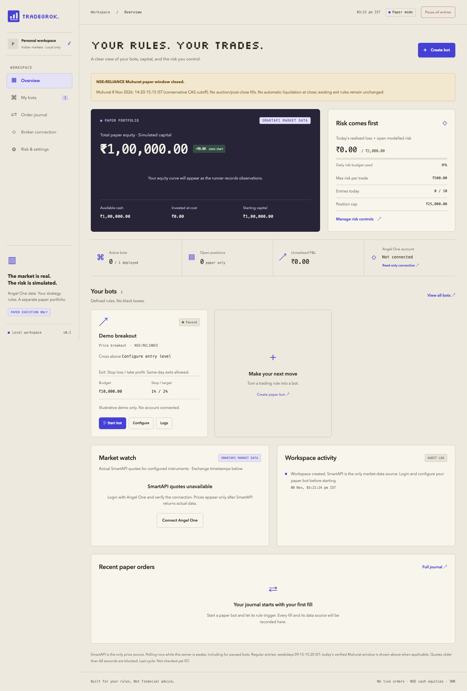
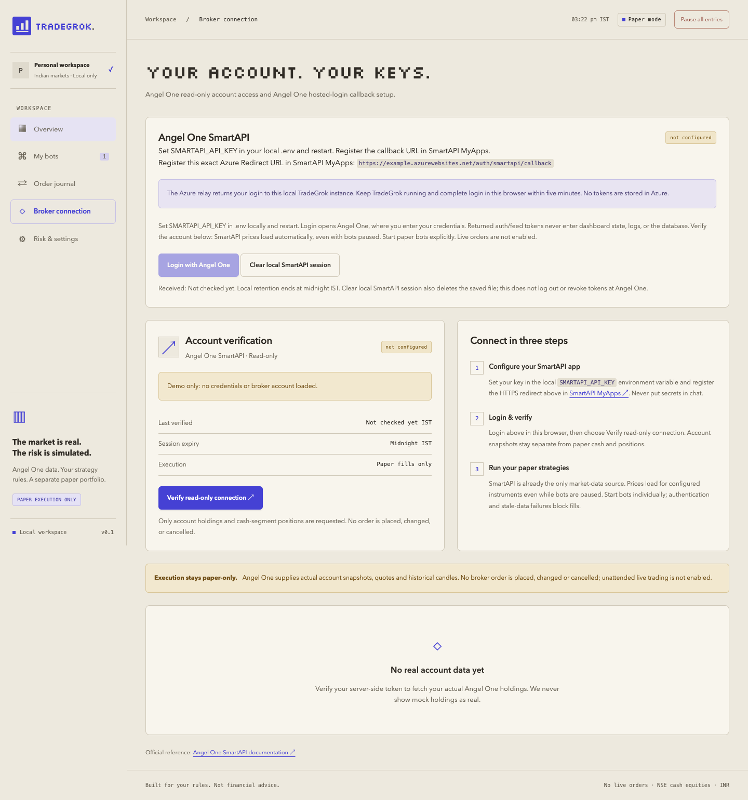
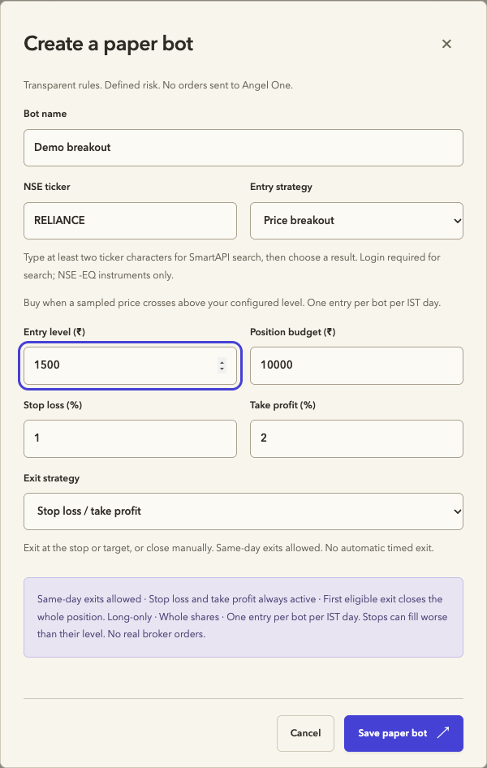
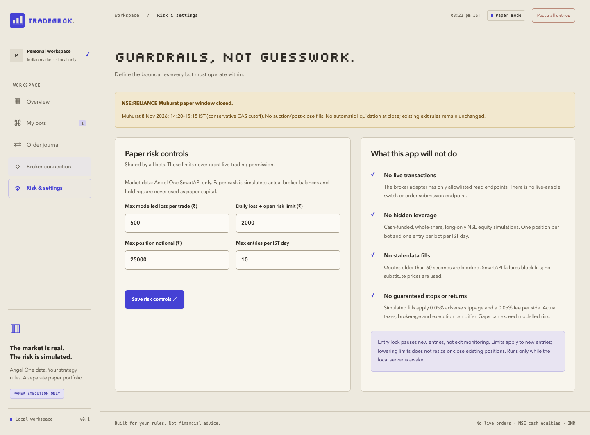

# TradeGrok

**Your rules. Your trades. Real market data, simulated execution.**

A local-first trading desk for Indian markets. Connect Angel One SmartAPI, view your real holdings separately, and test transparent entry and exit rules in a paper portfolio with shared risk limits.

> **Paper execution only.** TradeGrok cannot place, modify or cancel broker orders. There is no live-trading switch. This is an experimental strategy-testing tool, not financial advice or a promise of returns.



*All screenshots use a fresh, in-memory demo with no broker credentials, account holdings, private trading history or live quotes. The displayed capital is simulated.*

## What you can do

| Feature | What it does |
| --- | --- |
| Local trading desk | Paper equity, cash, positions, risk usage, market watch and workspace activity in one dashboard. |
| Angel One connection | Hosted broker login, read-only holdings and NSE cash-segment positions, actual quotes and historical candles. |
| Paper bots | Price breakout, buy-the-dip, moving-average cross and manually configured swing breakout. |
| Independent exits | Stop/target, moving-average reversal, support breakdown, holding-period, scheduled and time-plus-performance rules. |
| Shared guardrails | Per-trade modelled loss, daily loss plus open risk, position cap, cash checks and daily entry limits. |
| Order journal and analysis | Inspect simulated fills and per-cycle decision records, including blocked conditions. |
| Historical replay | Any configured bot and chosen NSE cash ticker, using your Angel One account's one-minute candles from the last 1–7 calendar days; saved history, decision logs, net P/L and win/loss report. |

The bot-bin hint, Muhurat-window notices and stale/unavailable valuation notices have an **×** dismissal button. Removing one hides it across automatic refreshes and navigation in the current tab; changed content or a page reload shows it again. The bot bin stays accessible from the sidebar. Other dashboard notices have expandable details: select a headline to expand or collapse it. Routine notices start collapsed; critical errors and the entry lock start expanded. Expansion choices survive automatic refreshes and page changes; changed content resets to its default.

Broker connection keeps login, verification, status and the callback URL visible. Setup instructions, session details and paper-execution information are collapsed by default; verification failures stay expanded.

The interface is vanilla JavaScript and CSS, with locally hosted Silkscreen headings. The server uses Node's built-in HTTP and SQLite modules: **no third-party runtime dependencies, frontend build or Python SDK required.**

### Download history and backtest

In **My bots → Historical backtesting**, choose a configured bot, an NSE cash ticker (uppercase, without `NSE:` or `-EQ`), and **1–7 calendar days**. Candles are fixed at **one minute**. The current IST date counts toward the limit; incomplete sessions, weekends and holidays are excluded, never replaced by older sessions. Downloads use your current Angel One SmartAPI login and resolve exactly one `NSE` / `-EQ` instrument; no synthetic data, derivatives or broker orders.

Use **Run** to fetch and replay together. Complete, checksum-verified one-minute sessions already saved for that ticker are reused automatically, even from another bot's run or a different date window; only missing sessions are downloaded. For example, Monday's last-seven-calendar-day window shares six calendar dates with Sunday's window: common completed trading sessions are reused and only new completed sessions are fetched. Weekends and holidays have no candles to download. Fully cached windows work without a current login. The popup reports reused/downloaded session counts and offers **Download saved candles** as JSON. **Run selected bot on saved ticker history** uses the exact saved window with the selected bot's current settings; **Replay original settings** reproduces the saved snapshot. Entry/support price levels are not automatically rescaled for a different ticker.

The legacy `/api/backtest` request with `downloadOnly: true` still fetches fresh history without replaying; it can replace a corrupted cache window after signing in. There is no separate history-only button in the UI.

Backtest guidance, assumptions and entry/exit strategy descriptions are grouped under **Learn more about backtest** at the end of **My bots**, collapsed by default. Its open/closed state survives page refresh polling and navigation within the current page load. Setup controls and operational alerts remain visible.

All four entry presets and all six exit presets are supported. Completed one-minute closes replace polling samples; signals fill at the next same-session continuous open. Stops/targets use actual open gaps and intrabar extremes, with stop first if both touch. Timed and performance rules use simulated entry time and trading-session counts. Sizing uses saved risk limits and fresh initial simulated capital, not current paper cash or real buying power. One entry per bot per IST day; positions may carry overnight and any remainder is liquidated at the final continuous close.

Replay conservatively uses the common continuous window **09:15–15:15 IST** from 3 August 2026 (09:15–15:30 earlier). The verified 8 November 2026 Muhurat window is **14:20–15:15 IST**. Later prints and auction marks stay in the download but are not traded; this deliberately excludes valid later non-CAS trading rather than guessing a ticker's auction eligibility. Only verified 2026 calendar windows are supported. Missing or zero-volume continuous candles save a blocked dataset without fabricating a result.

Results open in a separate popup after a download or replay; use **View latest results** to reopen them, and **Close results**, **×**, or Escape to return to the setup controls. The popup contains net P/L, return, trades, wins, losses, breakevens, win rate (N/A for no trades), fees, slippage, close-equity drawdown, candle coverage and downloads. Blocked runs and logging failures remain explicit in the popup. Costs model 0.05% adverse slippage and 0.05% fees per side, not actual Angel One brokerage/taxes; trade P/L includes both entry and exit fees. Download the full report for simulated fills, equity, assumptions and per-bar decision records. The normal bot log viewer also shows **Backtest**-labelled records on each historical date; file-write failures are surfaced and the full records remain in the saved report. Active bot settings, cash, positions and the paper order journal are unchanged. Legacy safe-play five-minute reports remain downloadable.

## Quick start

Install [Node.js 24 or newer](https://nodejs.org/), including npm, and Git.

```sh
git clone https://github.com/shubhankarsharma00/TradeGrok.git
cd TradeGrok
node --version
```

Create your **own local** configuration without overwriting an existing file:

```sh
# macOS / Linux; run from the repository root
if [ ! -e .env ]; then
  (umask 077; cp .env.example .env)
fi
chmod 600 .env
npm start
```

On Windows PowerShell:

```powershell
if (-not (Test-Path .env)) { Copy-Item .env.example .env }
npm start
```

Keep `.env` accessible only to your Windows user using filesystem permissions; `chmod` instructions apply to macOS/Linux.

Open **http://127.0.0.1:3100**. A fresh installation has 100,000 INR of simulated cash and one paused bot. You can explore the UI without connecting an account; market prices and paper execution require verified SmartAPI access. The empty API key and relay fields in `.env.example` are intentional.

### Configure `.env`

Use **Broker connection → Broker setup guide → SmartAPI & .env** to enter the relay origin and API key, then select **Save to local .env**. The form sends values only to the local TradeGrok server and saves an owner-only `.env`; it does not upload them to GitHub or Cloudflare, log them, or return the saved key to the dashboard. Restart TradeGrok to load the saved configuration. Angel One receives the API key when you use its login/API.

You can instead edit `.env` locally in your editor, not in GitHub, an issue, a screenshot or chat:

```dotenv
PORT=3100
SMARTAPI_API_KEY=REPLACE_WITH_YOUR_OWN_API_KEY
SMARTAPI_RELAY_ORIGIN=https://tradegrok-smartapi.YOUR_SUBDOMAIN.workers.dev
```

| Variable | Purpose |
| --- | --- |
| `PORT` | Local HTTP port, default `3100`; must be an integer from `1024` to `65535`. |
| `TRADEGROK_DATA_DIR` | Optional existing local data directory for the SQLite portfolio, private saved session and analysis logs. Defaults to this checkout's `data/`. Use an absolute path when restarting from another checkout; stop the old server first. |
| `TRADEGROK_ENV_FILE` | Optional local `.env` path used by the broker settings save form. Defaults to this checkout's `.env`. When loading another configuration via Node's `--env-file-if-exists`, set this to that same absolute path so saves and restarts use the same file. |
| `SMARTAPI_API_KEY` | Your SmartAPI app's API key. Required for login; keep it local. |
| `SMARTAPI_RELAY_ORIGIN` | Your callback relay's public HTTPS origin, **without** a path, query or explicit port. Leave blank for disconnected exploration/development only. |

Replace both placeholders before connecting. Cloudflare is the recommended free HTTPS relay; you can instead set `SMARTAPI_RELAY_ORIGIN` to your own Azure App Service's exact HTTPS origin. Restart `npm start` after changing configuration. Do not copy someone else's key or deployment URL. There is no client PIN, password, client code or TOTP-secret setting in TradeGrok: those belong in Angel One's hosted login.

## Set up Angel One and SmartAPI

For a dedicated walkthrough, see [Broker onboarding and verification](docs/onboarding/README.md), including relay checks, login verification and troubleshooting.

Open **Broker connection** in the dashboard (or **http://127.0.0.1:3100/#broker**) for the four-step setup guide. It starts collapsed and preserves the selected step and expanded/collapsed state across refreshes and page navigation. Step 3 saves the relay origin and API key to local `.env`, or shows instructions for editing it directly. Unsaved fields survive automatic refreshes; navigation asks before discarding them. Step 4 provides **Click here to test Angel One login**, enabled after restarting with the API key and HTTPS relay loaded. Returning from hosted login selects the verification step. You still create your own broker account and deploy the relay; navigating the guide does not certify setup.

### 1. Prepare your broker account

You need your own active [Angel One](https://www.angelone.in/) account with access to the instruments/data you want to use. Complete the broker's current account onboarding and login/2FA requirements directly with Angel One. TradeGrok does not open accounts or change account settings.

Sign in to the [SmartAPI developer portal](https://smartapi.angelone.in/) and open **MyApps**. Create/configure your own application and obtain its API key. Portal labels, account eligibility, API entitlements and any network/static-IP requirements can change: check the [official documentation](https://smartapi.angelone.in/docs) for your app type. A callback relay is **not** a proxy for quote/account requests and does not provide a static outbound IP for your computer.

**Static-IP allowlisting is separate from the HTTPS Redirect URL.** Broker API requests originate from the computer running local TradeGrok, not the Cloudflare or Azure relay. If your app requires an IP allowlist, use that computer's **public outbound IPv4**, not `127.0.0.1`, a private LAN address, or the relay's IP. Check it from the same computer and network:

```sh
curl --fail --silent --show-error --ipv4 https://api.ipify.org
```

This reports your **current public IP**, not proof that it is static. Ask your ISP for a guaranteed static public IPv4 if the broker requires one. Dynamic addresses can change after reconnecting, switching networks or using a VPN. Free Cloudflare HTTPS does **not** provide a static outbound IP for local broker requests. After a network change, recheck your IP, update the broker allowlist if needed, and restart TradeGrok because its public-IP lookup is cached for the process. Do not hard-code a one-time lookup into customer configuration.

### 2. Deploy your public HTTPS callback relay

> **Recommended: Cloudflare Workers Free provides a public HTTPS callback for $0 within its free-plan limits.** Its included `workers.dev` address needs no purchased domain, certificate or paid tunnel. The Free plan includes **100,000 requests/day**; this callback-only relay needs no paid storage or database. Stay on Free and do not enable paid services to work around quotas.

Angel One registration requires a public HTTPS redirect URL; **do not register loopback or expose the local dashboard through a public tunnel**. Choose **Cloudflare Workers** below or the collapsed **Azure App Service alternative**. Deploy only the stateless relay; your broker keys, tokens, dashboard and financial database stay local. Confirm SmartAPI accepts your chosen exact hostname. Free-tier hosting is not a business-critical availability guarantee.

#### Cloudflare Workers (recommended, free HTTPS)

1. Use your own Cloudflare account and the **Workers Free** plan. Select your `workers.dev` account subdomain in Workers & Pages. No domain purchase is required.
2. In `wrangler.jsonc`, replace `YOUR_SUBDOMAIN` in `vars.PUBLIC_ORIGIN` with your actual subdomain. If you change `name`, update the first hostname component too. Set `vars.LOCAL_RETURN_ORIGIN` to `http://127.0.0.1:<PORT>` using your local port. These are nonsecret settings; never add broker keys or tokens. `PUBLIC_ORIGIN` must exactly match the deployed HTTPS origin, without a port/path.
3. Keep `"observability": { "enabled": false }`, `"logpush": false` and `"preview_urls": false`. New Workers otherwise enable observability by default. Before real login, verify Workers Logs/invocation logs are disabled, with no traces, Tail Workers, Logpush/export integrations, logging proxies or request-capture tools attached. Do not use `wrangler tail` or dashboard live logs during real login: callback queries and response `Location` headers contain tokens.
4. Use Wrangler 4 as deployment tooling only; it is not a TradeGrok runtime dependency:

```sh
npx wrangler@4 login
# Package locally without deploying.
npx wrangler@4 deploy --dry-run
# Deploy after checking your account, hostname and logging settings.
npx wrangler@4 deploy
```

Wrangler bundles only `server/cloudflare.js` and its imported relay/header/error helpers. No `.env`, database, private session, frontend, tests or runner is uploaded. Do not add assets, KV, R2, D1, service bindings or `nodejs_compat`; do not publish the whole folder with Pages or tunnel the dashboard.

5. Check your actual HTTPS address:

```sh
curl --fail https://tradegrok-smartapi.YOUR_SUBDOMAIN.workers.dev/healthz
# Expected: {"status":"ok"}
```

`/`, `/api/state`, bot/settings/emergency endpoints and local file paths must return `404`; non-GET callbacks must be rejected. Health does not prove a broker login works. Before real login, use synthetic tokens to check the fixed fragment return and rejection of replay/wrong-browser handoffs, without overwriting an active saved broker session.

Register `https://tradegrok-smartapi.YOUR_SUBDOMAIN.workers.dev/auth/smartapi/callback` using your real subdomain, then follow step 3 below. A 403 indicates a wrong host or non-HTTPS request; do not weaken origin validation. A 500 from health indicates invalid/missing configuration. For `login_incomplete`, start a new login. If you change variables in Cloudflare's dashboard, also update `wrangler.jsonc` before deploying again. Quota failures require waiting/retrying, not automatic paid upgrades.

`workers.dev` is intended for personal/hobby projects, not business-critical production. Cloudflare terminates TLS and processes incoming credentials: this is not end-to-end encryption against the hosting provider. Disabling application logging does not guarantee anything about provider-internal retention. The broker delivers tokens directly; the relay cannot substitute authorization codes or PKCE.

References: [Workers Free pricing](https://developers.cloudflare.com/workers/platform/pricing/), [workers.dev addresses](https://developers.cloudflare.com/workers/configuration/routing/workers-dev/), [Wrangler configuration](https://developers.cloudflare.com/workers/wrangler/configuration/) and [Workers Logs](https://developers.cloudflare.com/workers/observability/logs/workers-logs/).

<details>
<summary>Alternative: Azure App Service setup (Free F1)</summary>

#### Azure Linux App Service

1. Create/select your own Linux App Service with a supported Node.js runtime (**22+ for the relay; 24+ for the local dashboard**). Check current pricing, region availability, quotas and your subscription before creating resources. A Free F1 plan may be suitable where available, but can idle or hit quotas; no free availability or cost guarantee is implied.
2. Note the app's actual default HTTPS hostname, including any generated suffix. In App Service environment settings, set `PUBLIC_ORIGIN=https://YOUR-APP.azurewebsites.net` and `LOCAL_RETURN_ORIGIN=http://127.0.0.1:3100`, replacing the hostname with the real one. `.env.azure.example` is a **nonsecret reference template**, not an automatically loaded cloud env file.
3. Set startup to **`node server/azure.js`**. Azure supplies `PORT`, `WEBSITE_SITE_NAME` and `WEBSITE_HOSTNAME`; the relay requires `PUBLIC_ORIGIN` to match that supplied hostname.
4. Enable HTTPS Only and TLS 1.2 or newer. This callback must be publicly reachable without a second login redirect; do not enable App Service Authentication/Easy Auth for it. Do not put broker credentials or your local `.env` in App Service.
5. **Before a real login**, disable HTTP/access logs, detailed errors, failed-request tracing and application request/body/header logging. Leave Application Insights and logging proxies/CDNs off. Callback queries and redirect `Location` headers contain tokens and must not be captured.
6. Deploy **only** the allowlisted relay bundle below, not the whole project or your workspace.

Build a relay-only ZIP from a clean checkout on macOS/Linux:

```sh
# Refuses to overwrite an existing relay staging directory.
mkdir .relay-build &&
mkdir .relay-build/server &&
cp server/azure.js server/azure-callback.js server/smartapi-relay.js \
  server/http.js server/broker.js .relay-build/server/ &&
printf '%s\n' '{"name":"tradegrok-callback-relay","private":true,"type":"module","engines":{"node":">=22.0.0"},"scripts":{"start":"node server/azure.js"}}' \
  > .relay-build/package.json &&
(cd .relay-build && zip -q -r ../tradegrok-relay.zip package.json server)
```

Keep `.relay-build/` and the ZIP out of Git. This bundle intentionally contains no `.env`, database, private session, frontend, tests or runner. It is ready to run with no dependency installation/build.

With the [Azure CLI](https://learn.microsoft.com/en-us/cli/azure/install-azure-cli), sign in using `az login`, then deploy to your own existing resource:

```sh
az webapp deploy \
  --resource-group YOUR_RESOURCE_GROUP \
  --name YOUR_APP_NAME \
  --src-path tradegrok-relay.zip \
  --type zip
```

Deployment restarts the app. You can also upload the ZIP to [Azure Cloud Shell](https://learn.microsoft.com/en-us/azure/cloud-shell/get-started/ephemeral) and use its CLI, adjusting the file path; use ephemeral/no-storage mode if appropriate rather than inadvertently provisioning persistent storage. See [ZIP deployment](https://learn.microsoft.com/en-us/azure/app-service/deploy-zip) and [Node.js App Service configuration](https://learn.microsoft.com/en-us/azure/app-service/configure-language-nodejs).

Check the relay before using real credentials:

```sh
curl --fail https://YOUR-APP.azurewebsites.net/healthz
# Expected: {"status":"ok"}
```

`/`, `/api/state` and local file paths should return `404`. Only `/healthz` and `/auth/smartapi/callback` are available. Health does not prove a broker login works.

</details>

### 3. Register the redirect and connect locally

In SmartAPI **MyApps**, register this exact **Redirect URL**, using your actual relay hostname:

```text
https://tradegrok-smartapi.YOUR_SUBDOMAIN.workers.dev/auth/smartapi/callback
```

Set `SMARTAPI_RELAY_ORIGIN` to the **same origin without `/auth/smartapi/callback`**, and set that app's `SMARTAPI_API_KEY` in your local `.env`. Restart the local server.

For Azure, substitute the exact HTTPS App Service hostname. To switch providers, deploy/check the new relay first, then update the SmartAPI Redirect URL and local `SMARTAPI_RELAY_ORIGIN` together, restart TradeGrok and start a new login. Only one relay is selected at a time; there is no automatic fallback that sends credentials to another host. Each relay has a fixed local return port; customers using different ports need their own deployment/configuration.

1. Open **http://127.0.0.1:3100** and choose **Broker connection → Login with Angel One**.
2. Complete the broker's hosted sign-in in the **same browser within five minutes**, keeping TradeGrok running. Enter your client credentials and any PIN/OTP/TOTP only on the official broker page. Do not paste a QR secret or token into TradeGrok.
3. On return, **callback received** means tokens arrived, not that account access has been verified.
4. Select **Verify read-only connection**. Successful holdings/positions verification unlocks actual quote monitoring for configured instruments.
5. Configure bots, review risk controls and start each bot explicitly.

Use `127.0.0.1`, not `localhost`, so the browser-bound login cookie matches. If you change `PORT`, also change the relay's `LOCAL_RETURN_ORIGIN`. The public redirect remains on the relay hostname.



### How login works

```mermaid
sequenceDiagram
    participant Browser
    participant Local as Local TradeGrok
    participant Broker as Angel One
    participant Relay as Cloudflare or Azure HTTPS relay
    Browser->>Local: Start login
    Local-->>Browser: Hosted login URL + browser-bound cookie
    Browser->>Broker: Authenticate on broker page
    Broker-->>Relay: Callback with state and auth/feed tokens
    Relay-->>Browser: Redirect to fixed loopback return with URL fragment
    Browser->>Local: Same-origin token handoff
    Local->>Local: Validate state/cookie; save private daily session
    Browser->>Local: Verify read-only connection
    Local->>Broker: Request holdings and positions
```

The local server checks single-use state, a browser-bound HttpOnly cookie, the exact callback/Origin and a five-minute deadline. Both relays are stateless: they redirect to a fixed loopback origin and have no token retrieval endpoint or database. The local landing page scrubs the token-bearing fragment before posting it back to the server. Never share a callback address, browser history, redirect header or network capture.

## Configure a paper strategy

Choose **My bots → Create bot**, or **Configure** on a paused bot without an open position. Search with at least two ticker characters after login, then choose an exact NSE cash `-EQ` result. Enter the bare ticker, such as `RELIANCE` or `M&M`, not `NSE:` or `-EQ`.

Use **Move to bin** on a paused bot without an open paper position to remove it from the active workspace. Close any held paper position first so exit monitoring is not lost. Removed bots stop polling and no longer count toward the 12-bot limit. **My bots → Bot bin → Logs** keeps their saved, date-filtered analysis reviewable; paper orders, cash accounting and daily risk history are preserved across restarts. The bin does not permanently erase bots or provide a restore action.



| Entry preset | Trigger |
| --- | --- |
| Price breakout | Previous sampled price at/below your level, current price above it. Starting already above does not trigger. |
| Buy the dip | Current sampled price at/below your configured level. |
| Moving-average cross | 5-sample average crosses above 12-sample average; needs 13 observations. |
| Swing breakout | The sampled breakout rule applied to a resistance level you choose from a daily chart. Illustrative defaults: 3% stop, 6% target, minimum 2:1 configured reward/risk. |

Polling observations are **not exchange candles**. Swing mode does not automatically compute trend, resistance, ATR, earnings or volume confirmation. Choose the entry level yourself; blank levels are not invented from an unavailable quote.

Choose an exit independently: protective stop/target, 5/12 moving-average reversal, support breakdown, maximum holding period, scheduled exit or a one-time time-plus-performance check. Stop/target protection remains active with every exit preset; the first eligible exit closes the whole paper position. Stop/target takes priority over simultaneous custom signals.

Timed rules count entry day as session 1 and accept 1-60 sessions and **09:15-15:14 IST**. They use the verified **2026** NSE calendar plus the supported 8 November 2026 Muhurat exception; unsupported years/special-session boundaries block timed decisions with an alert. If the app misses a deadline, the next eligible fresh quote is used, not a fabricated historical fill.

## Risk and execution model



- Long-only, whole-share NSE cash-equity simulations; no shorts, derivatives, leverage, averaging down or pyramiding. Up to 12 bots, one position and one entry per bot per IST day.
- Size is constrained by bot budget, position cap, simulated cash including fees, per-trade modelled stop loss and remaining daily risk.
- Daily risk uses realised losses net of gains plus entry fees and currently reserved stop risk, **not** gross cumulative losses or maximum intraday drawdown. Gaps can exceed modelled limits.
- Simulated fills apply **0.05% adverse slippage and 0.05% fee per side**. Real taxes, brokerage, liquidity and execution differ. A stop is not a guaranteed fill price.
- Entries and exits require eligible execution windows and a matching broker exchange timestamp no older than **60 seconds**. Missing, malformed or failed quotes block the whole cycle, including exits; no synthetic fallback prices are used.
- **Pause all entries** and bot pause prevent new entries, not exit monitoring or automatic flattening. Positions can carry overnight. No global end-of-day square-off exists.
- Monitoring only works while the local server/computer and data feed are available. No broker-side protective orders exist. Lowering limits does not resize existing positions.

The regular execution window is weekdays **09:15-15:20 IST**. A date-specific Muhurat exception on 8 November 2026 follows [NSE circular CMTR76941](https://nsearchives.nseindia.com/content/circulars/CMTR76941.pdf): 14:20-15:30 for the configured NIFTYBEES non-CAS instrument; other symbols conservatively stop at 15:15. No auction/post-close fills are simulated. This is not a complete live-ready holiday/special-session gate.

Actual broker holdings never become paper capital or positions. Journal exit P&L excludes the separately recorded entry fee; total equity includes both fees. Equity and unrealised P&L use each held instrument's latest valid SmartAPI quote, including saved stale prices when the market is closed or the feed is unavailable. Saved valuation quotes survive server restarts and are never used for fills. Stale valuations are labelled with the oldest position quote's time, not presented as live values. If any held instrument has no valid saved or current quote, valuation remains unavailable; purchase cost is never substituted. The equity chart records fresh valuations only.

### Historical backtest

The **My bots** backtest panel requires exactly one bot named **`safe play`** using **RELIANCE**, SMA entry and protective stop/target exits. It downloads seven completed NSE sessions plus two warm-up sessions of actual five-minute candles. A current login is required for download.

This replay uses next-bar-open fills, the same modelled fee/slippage, conservative same-bar stop/target conflicts and strict continuous-session coverage. RELIANCE requires 72 continuous bars/day; the closing auction is excluded. Missing/zero-volume/unsupported sessions block performance results, rather than substituting older days. Saved datasets can be downloaded and replayed with their original configuration/hash without altering your paper bots. It is not a generic multi-symbol backtester, tick replay or prediction.

## Local data and privacy

| File/location | Contents | Handling |
| --- | --- | --- |
| `.env` | Your private API key and local configuration | Ignored by Git; never upload. |
| `data/tradegrok.sqlite` and sidecars | Paper bots, cash, positions, orders, events, equity, saved valuation quotes and backtests | Private financial state; back up safely with the server stopped. |
| `data/private/smartapi-session.json` | Daily auth/feed tokens and retention metadata | Plaintext credentials; exclude from backups, sync and uploads. |
| `data/logs/analysis-YYYY-MM-DD.jsonl` | Per-cycle strategy decisions and risk checks | Private financial logs; persist and grow until you manage them locally. |
| `.env.example`, `.env.azure.example` | Empty keys/generic setup templates | Safe to commit; never replace placeholders with your real credentials. |

On macOS/Unix, the session directory/file use owner-only `0700`/`0600` permissions and atomic writes. Tokens are restored only until their original **midnight IST** expiry; restart does not extend it, and account verification must be repeated after restart. A stopped app cannot remove an expired file at midnight, but refuses to load it later.

**Clear local SmartAPI session** deletes the saved local session; it does not revoke tokens or log out at Angel One. Normal shutdown preserves today's session. Corrupt/unsafe session files block startup visibly. Tokens never enter dashboard state, SQLite or application logs; raw callback URLs must still be treated as secrets.

The local dashboard binds to loopback and has no remote-user authentication. **Never deploy it publicly**, bind it to a public interface or tunnel it to the internet. Local Host/Origin checks, CSRF protection, CSP and static-file allowlisting do not isolate other programs running as you.

Before publishing your own changes, inspect `git diff --cached` and `git ls-files`. Ignore rules are not protection against forced adds or already tracked files. Screenshots, issue attachments and archives need the same privacy review as source code.

## Troubleshooting

| Symptom | Action |
| --- | --- |
| `node:sqlite` or env-file option unavailable | Use Node.js 24+ for the dashboard; check `node --version`. |
| Login disabled / not configured | Set your API key in local `.env` and restart. |
| Loopback redirect rejected | Register your relay's public HTTPS callback, not `127.0.0.1`. |
| Callback rejected / expired | Start a new attempt in the same browser within five minutes; use the exact `127.0.0.1` port and keep the server running. |
| Relay unavailable | Check `/healthz`, your exact deployed hostname and provider settings. Cloudflare can hit free-plan quotas; Azure F1 can idle or hit quotas. |
| Callback received but quotes unavailable | Select **Verify read-only connection**; callback receipt alone does not verify broker access. |
| Account verification error | Check the displayed operation/status/code and broker service status. Successful HTTP alone is insufficient; `AB2001`/`AB1004` can indicate broker failures, not an empty portfolio. |
| Quotes stale / market closed | Capital uses labelled last known SmartAPI prices. Fills still wait for eligible fresh exchange data; never replace it with made-up prices. |
| Too many requests | Search/data calls are serialized at least 1.1 seconds apart; multiple symbols slow a cycle. Allow retries/time between account refreshes. |
| Changed network | Restart: the process caches a credential-free public-IP lookup used for broker headers. Follow any current broker IP policy. |
| Browser blocks local return | Do not bypass safety warnings; use a supported browser configuration and retry a new login. |
| Timed exit blocked | Review the supported calendar year/session, freshness and configured deadline. Do not assume future holidays are supported. |

## Development

```sh
npm run dev     # Watch-mode local server; reads your local .env
npm run check   # JavaScript syntax checks
npm test        # Node's built-in test runner
```

```text
public/                   Browser dashboard and licensed local font
server/index.js           Loopback-only application entrypoint
server/app.js             Local API and static assets
server/smartapi.js         Hosted login, state and session handling
server/smartapi-relay.js   Shared origin/token validation and fixed return
server/angel.js            Read-only account and actual quote adapter
server/history.js         Broker historical data and request handling
server/engine.js           Paper execution and risk checks
server/backtest.js         Scoped historical replay
server/market-calendar.js  Supported trading-session rules
server/store.js            SQLite persistence
server/session-file.js     Private daily token persistence
server/analysis-log.js     Local strategy-decision logs
server/cloudflare.js       Cloudflare Workers callback entrypoint
wrangler.jsonc            Nonsecret Cloudflare deployment template
server/azure.js            Alternative Azure relay entrypoint
server/azure-callback.js   Azure request/transport validation
tests/                    Synthetic fixtures and behavior tests
docs/screenshots/         Credential-free demo screenshots
data/                     Generated locally; never committed
```

`npm start` is the local dashboard. `npx wrangler@4 deploy` publishes only the Cloudflare relay; `npm run start:azure` starts the alternative, separately configured Azure relay. Do not interchange their deployment environments.

The bundled font's [SIL Open Font License](public/fonts/OFL.txt) is retained. Angel One/SmartAPI names belong to their respective owners; this project is not an official broker product.
